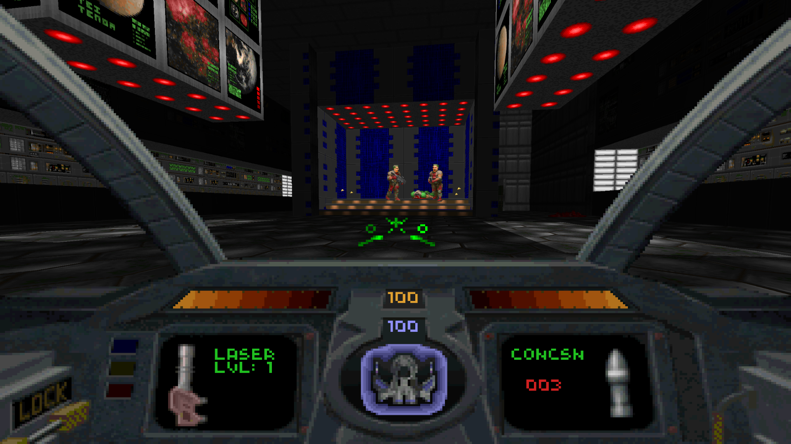

# Doomscent

Doom plus Descent: fly the Pyro-GX through Doom's levels with Descent's
six-degrees-of-freedom flight, cockpit and weapons.



▶ **[Watch it in action on YouTube](https://www.youtube.com/watch?v=-WYTXA3c60Q)**

Doomscent is a mod for an unmodified [GZDoom](https://zdoom.org/downloads)
(4.14 or newer). Doom monsters, maps and music stay as they are. The player
becomes Descent's ship:

- **Full 6DOF flight.** Thrust, slide and bank, loop and fly upside down.
  Movement uses Descent's own physics (thrust 7.8, mass 4, drag 0.033,
  rotational drag, the bank when turning), ported from the Descent 1 source.
- **Descent's cockpit.** Energy and shield gauges, the shield ring, key
  lights, weapon boxes and the reticle, laid out as in Descent, plus the
  rear view and Descent's message line for all game messages.
- **Descent's weapons.**
  - Primaries: lasers (levels 1-4 plus quad), vulcan, spreadfire, plasma, and
    fusion (charge by holding fire).
  - Secondaries: concussion, homing and smart missiles, proximity bombs, mega
    missile. Plus flares.
  - Damage, speed, fire rate and energy cost come from Descent's weapon tables,
    and the lasers, missiles and fusion bolt use Descent's own 3D models.
- **Descent powerups.** Doom's pickups are replaced by Descent's spinning
  powerups: health becomes shields, armour and cells become energy, and Doom
  weapons become Descent weapons.
- **Descent II mode** (optional): Descent II's cockpit, sounds and music,
  its extra weapons (super laser, gauss, helix, phoenix, omega; flash,
  guided, smart mine, mercury and earthshaker missiles) and its equipment
  (afterburner, headlight, energy converter, ammo rack). See below.
- **Descent's music** as an option, instead of the game's own.
- **Doors and switches** work when you fly into them, and switches can also
  be shot, as in Descent (a near miss counts). Exit switches only respond to
  shots from close by (about 200 units), so a stray shot can't end the level.
  The use key works too, with a longer reach than Doomguy's.

## Install and play (Windows)

1. Download the latest `Doomscent-x.y.z.zip` from
   [Releases](https://github.com/wootbeer/Doomscent/releases) and unzip it
   anywhere, e.g. `C:\Games\Doomscent`.
2. Copy your game files into its `data` folder:
   - a game IWAD: Doom (`DOOM.WAD`, `DOOM2.WAD`, `TNT.WAD`, `PLUTONIA.WAD`,
     the shareware `DOOM1.WAD`), [Freedoom](https://freedoom.github.io/)'s
     `freedoom2.wad`, Chex Quest (`chex.wad`, `chex3.wad`), Heretic
     (`HERETIC.WAD`) or Hexen (`HEXEN.WAD`);
   - `DESCENT.HOG` and `DESCENT.PIG` from Descent 1 (registered 1.4/1.5 is
     tested; shareware should work but is untested).
3. Double-click `Doomscent.bat`.

For **Descent II mode**, also copy `DESCENT2.HOG`, `DESCENT2.HAM`,
`GROUPA.PIG` and `DESCENT2.S22` from Descent II into `data` and start
`Doomscent2.bat` instead (or `Doomscent.bat -descent2`). Descent 1 stays
the default; with only Descent II's files in `data`, `Doomscent.bat` uses
Descent II mode.

On the first run the launcher:

- offers to download [GZDoom](https://zdoom.org/downloads) 4.14.2 into a
  `gzdoom` folder (or set the `GZDOOM` environment variable to an existing
  `gzdoom.exe`);
- converts your Descent files into `dd_descent_assets.pk3` (cockpit,
  gauges, sprites, models, sounds).

After that it starts straight away. If you have several IWADs, GZDoom asks
which game to play. Extra arguments go to GZDoom, e.g.
`Doomscent.bat -iwad DOOM2.WAD +map MAP01`.

**No game data is included**, and the generated `dd_descent_assets.pk3`
(and `dd_descent2_assets.pk3`) contain Descent's data, so don't share them. The retail Descent is sold on
GOG and Steam.

Windows SmartScreen or antivirus may be wary of `tools\ddconvert.exe`,
since it isn't code-signed. It is built from `tools/ddconvert.py` by this
repository's GitHub Actions; with Python 3 installed you can delete the exe
and the launcher will run the script instead.

GZDoom needs its OpenGL or Vulkan renderer (the default); the software
renderer can't roll the view.

## Other mods

Doomscent works with gameplay mods such as Brutal Doom, Project Brutality
and Beautiful Doom: you fly the Pyro-GX through their monsters, gore and
effects. Put the mod's file (or folder) in the `mods` folder and start
Doomscent as usual; the launcher loads it first, so Doomscent's ship and
cockpit take over. The mod's weapons and pickups become Descent ones, by
type. (Running GZDoom yourself, list the mod before Doomscent's files:
`-file brutal.pk3 dd_descent_assets.pk3 doomscent.pk3`.)

## Linux / macOS

Install GZDoom 4.14+ and Python 3, put your files in `data/` as above, and
run `./doomscent.sh` (`./doomscent.sh --descent2` for Descent II mode).

## Running from source

Clone the repository, put your files in `data/`, and run `Doomscent.bat` (or
`./doomscent.sh`). With Python 3 installed, the launcher rebuilds
`doomscent.pk3` whenever something in `mod/` changes. By hand:

```
python tools/build_pk3.py doomscent.pk3
python tools/ddconvert.py data -o dd_descent_assets.pk3
gzdoom -iwad DOOM2.WAD -file dd_descent_assets.pk3 doomscent.pk3

# Descent II mode
python tools/ddconvert.py --descent2 data -o dd_descent2_assets.pk3
gzdoom -iwad DOOM2.WAD -file dd_descent2_assets.pk3 doomscent.pk3
```

To make a release, set `VERSION` and add a `CHANGELOG.md` entry, then either
push a tag `v<VERSION>` or run the Release workflow from the Actions tab with
"publish" ticked. It builds `ddconvert.exe` and the zip and publishes them.

## Controls

GZDoom's normal bindings mostly carry over. **Options → Doomscent Options →
Bind Descent-style keys** sets up the full layout:

| Action | Key |
|---|---|
| Thrust forward / back | W / S |
| Slide left / right | A / D |
| Slide up / down | Space / C (or Left Ctrl) |
| Pitch and turn | Mouse (arrow keys also turn and pitch) |
| Bank left / right | Q / E |
| Fire primary / secondary | Left / right mouse button |
| Select primary weapon | 1-5 (laser, vulcan, spreadfire, plasma, fusion; press again for Descent II's super laser, gauss, helix, phoenix, omega) |
| Select secondary weapon | 6-0 (concussion, homing, proximity, smart, mega; press again for Descent II's flash, guided, smart mine, mercury, earthshaker) |
| Cycle secondary | Middle mouse button |
| Fire flare | F |
| Drop proximity bomb | B |
| Rear view (tap to toggle, hold to peek) | V |
| Level the ship | Z |
| Use (or fly into doors/switches, or shoot switches) | R |
| Afterburner (Descent II) | Left Shift (X if you haven't bound the keys) |
| Headlight on/off (Descent II) | H |
| Energy to shield converter (Descent II) | G (hold) |

Mouselook must be on (the bind option turns it on).

The **Doomscent Options** menu also has:

- thrust, weapon damage and damage taken multipliers (at 1.0, thrust and
  weapon damage are Descent's and damage taken is Doom's; mouse speed is
  GZDoom's own mouse sensitivity setting);
- level (Doom-style) turning or Descent-style ship-axis turning;
- mouse momentum (on by default): turns ease in and out like Descent's
  instead of stopping dead;
- the ship's gentle Descent bob (on by default);
- banking into turns (off by default);
- auto-levelling;
- bump-to-open doors;
- the cockpit on or off;
- Descent's music instead of the game's (each level plays one of Descent's
  songs in turn, as Descent did);

## How Doom's items map to Descent

| Doom | Doomscent |
|---|---|
| Health bonus / stimpack / medikit | Shield +2 / shield boost / big shield boost |
| Soulsphere / megasphere | +100 shields / full shields and energy |
| Armour bonus / green / blue armour | Energy +2 / +50 / +100 |
| Cell / cell pack | Energy boost / +100 energy |
| Clip / box of bullets | Vulcan ammo |
| Shells / box of shells | Concussion missile / 4-pack |
| Rocket / box of rockets | Homing missile / 4-pack |
| Chainsaw, berserk | Laser upgrade (berserk also restores shields) |
| Shotgun | Spreadfire cannon |
| Super shotgun | Quad lasers |
| Chaingun | Vulcan cannon |
| Rocket launcher | Smart missile |
| Plasma rifle | Plasma cannon |
| BFG 9000 | Fusion cannon |
| Invulnerability / partial invisibility | Invulnerability / cloak |
| Backpack | Supply pack (vulcan ammo, missiles, bombs, energy) |
| Keys | Descent keys (still open Doom's locked doors) |

Custom PWADs (`-file mymap.wad`) work as long as they use the base game's
items and monsters.

## Descent II mode

Descent II mode keeps everything above and adds what Descent II brought.
The cockpit, gauges and weapon pictures are Descent II's high-resolution
ones, and its sounds and music are used.

- **Weapons.** Each number key holds a Descent 1 weapon and its Descent II
  successor; press the key again to switch. About half of Doom's weapon and
  missile pickups turn into the Descent II versions:

  | Doom | Descent 1 or Descent II |
  |---|---|
  | Shotgun | Spreadfire or helix cannon |
  | Super shotgun | Quad lasers or super laser |
  | Chaingun | Vulcan or gauss cannon |
  | Plasma rifle | Plasma or phoenix cannon |
  | BFG 9000 | Fusion or omega cannon |
  | Rocket launcher | Smart missile or 4 mercury missiles |
  | Shells / box of shells | Concussion or flash missiles |
  | Rocket / box of rockets | Homing or guided missiles |
  | Berserk | Super laser (and 100 shields) |
  | Megasphere | Shields, energy and an earthshaker missile |

  The guided missile is flown from its own view with the mouse; the omega
  cannon locks onto whatever is in front of it and recharges from energy.
- **Equipment.** The radiation suit becomes the afterburner, light
  amplification goggles the headlight, the computer map the full map, and
  the backpack also works as Descent II's ammo rack (double missile
  capacity) and fits the energy-to-shield converter.

## More than Doom

The same Pyro-GX flies through the other games GZDoom runs:

- **Chexscent** (Chex Quest 1 and 3): zorchers and Chex goodies become
  Descent weapons and powerups the same way as Doom's; Chex Quest's keys open
  its doors.
- **Herescent** (Heretic): the crossbow, dragon claw, hellstaff, phoenix rod
  and firemace become spreadfire, vulcan, plasma, smart missiles and fusion;
  wand crystals and claw orbs are vulcan ammo, ethereal arrows concussion
  missiles, phoenix orbs homing missiles, and runes and mace spheres energy.
  The Tome of Power upgrades your lasers.
- **Hexscent** (Hexen): each class's second and third weapons become
  spreadfire and plasma, and the pieces of the fourth become the fusion
  cannon. Blue mana is energy and green mana vulcan ammo; flechettes and
  banishment devices supply concussion and homing missiles.

Descent music and Descent II mode work in all of them. In Descent
II mode Heretic's and Hexen's torch is the headlight, Heretic's map scroll
the full map, and Hexen's boots of speed the afterburner.

In Heretic and Hexen, artifacts you carry and use (time bombs, morph ovums,
the chaos device, Hexen's puzzle items...) work as in the original: browse
them with `[` and `]` and use one with Enter. The selected one shows at the
top right. Keys without a Descent key light (Heretic's green key, Hexen's
keys) show as icons at the top left.

Strife isn't supported.

## Repository layout

```
mod/                  the GZDoom mod (ZScript, menus, key setup) -> doomscent.pk3
tools/ddconvert.py    converts your Descent (or, with --descent2, Descent II)
                      files into dd_descent_assets.pk3 / dd_descent2_assets.pk3
tools/build_pk3.py    zips mod/ into doomscent.pk3
tools/launcher.ps1    the Windows launcher (run by Doomscent.bat / Doomscent2.bat)
tools/make_release.py builds the release zip (used by .github/workflows)
Doomscent.bat, Doomscent2.bat, doomscent.sh   launchers
data/                 where you put your WADs and Descent files (git-ignored)
```

## Licence

Doomscent is free for **non-commercial** use. Parts of it are derived from
the Descent 1 source code release, which Parallax Software licensed for
non-commercial use. See [LICENSE](LICENSE).

GZDoom is a separate GPL program. Doom and Descent belong to their respective
owners. This project is not affiliated with id Software, Parallax Software or
Interplay.
